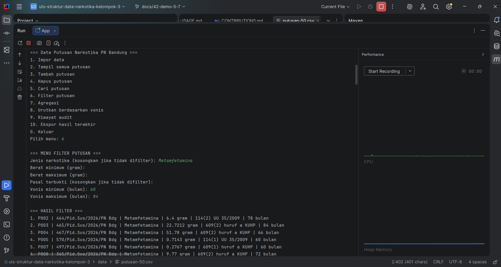
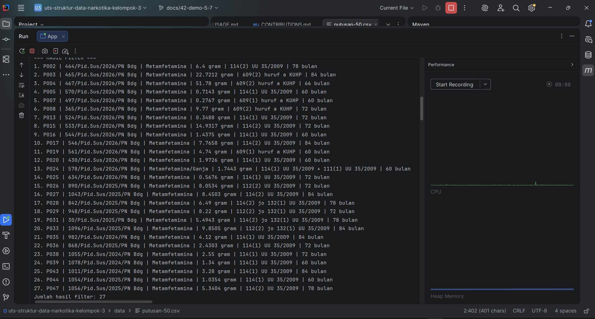

# Trace Skenario 5: Filter Gabungan

## Kriteria
- Jenis narkotika mengandung "Metamfetamina"
- Vonis 60–84 bulan
- Berat dan pasal tidak difilter

## Hasil
| Sumber | Jumlah | caseId |
|---|---|---|
| Aplikasi (menu 6) | 27 | P002, P003, P004, P005, P007, P008, P013, P015, P016, P017, P019, P020, P024, P025, P026, P027, P028, P029, P031, P033, P035, P036, P038, P039, P043, P044, P047 |
| Pemeriksaan manual Google Sheet (filter "Text contains: Metamfetamina" dan vonis 60–84) | 27 | P002, P003, P004, P005, P007, P008, P013, P015, P016, P017, P019, P020, P024, P025, P026, P027, P028, P029, P031, P033, P035, P036, P038, P039, P043, P044, P047 |

## Kesimpulan
Hasil aplikasi dan pemeriksaan manual **cocok**: jumlah (27) dan daftar caseId sama.
P024 (Metamfetamina/Ganja) ikut terambil karena filter jenis memakai "mengandung", sesuai rancangan.

## Tangkapan layar hasil menu 6

